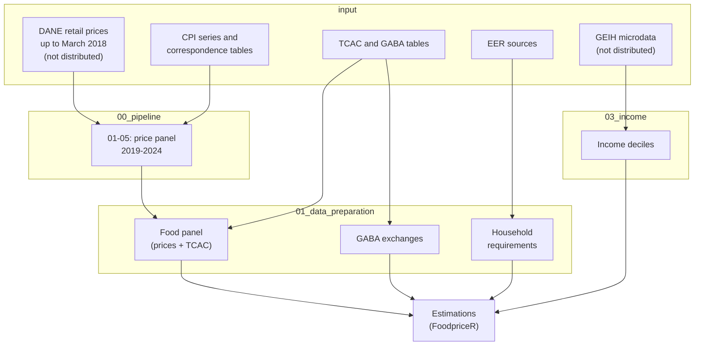

# least-cost-diets-colombia

This repository contains the data and the data preparation code for the paper "The Affordability of Least-Cost Diets in Urban Colombia: Evidence from Three Major Cities". The paper estimates the cost and affordability of a caloric adequate diet (CoCA), a nutritionally adequate diet (CoNA) and a recommended diet that meets the Colombian food-based dietary guidelines (CoRD) for Bogotá, Medellín and Cali between January 2019 and December 2024. It is based on an item-level retail price panel built from the CPI basket, and affordability is assessed by income decile using the Great Integrated Household Survey (GEIH).

The estimations are carried out with the R package [FoodpriceR](https://github.com/lea-puj/FoodpriceR), which is not part of this repository. Here we provide the inputs that the package uses and the scripts that build them. The repository is organized as follows. Each box is a folder, and the arrows show how the scripts turn the raw data into the inputs of the estimations.



All paths in the scripts are relative to the root folder of the repository, and they are defined in `00_config.R`. Thus, the scripts must be run from that folder, and each one starts with `source("00_config.R")`.

## Data availability

Not every input can be redistributed. The following files are not in the repository:

- The DANE retail price series for the items of the CPI basket (through March 2018), which DANE provided to the authors. The price panel built from them (`prices_paper.csv` and the food panel `panel_food_paper.rds`) is available from the corresponding author upon reasonable request, as stated in the data availability statement of the paper.
- The GEIH microdata (`personas` and `hogares` files of the poverty module, 2019-2024), which are published by DANE. They must be placed in `input/geih/personas` and `input/geih/hogares`.

## FoodpriceR

The least-cost diet metrics and the affordability indicators are estimated with [FoodpriceR](https://github.com/lea-puj/FoodpriceR), an R package for assessing the affordability of three least-cost diets (Barona-Montoya, Báez Palencia, Mosquera-Angulo and Valdés Cárdenas, 2026). The package is not on CRAN. It can be installed from GitHub:

```r
install.packages("remotes")
remotes::install_github("lea-puj/FoodpriceR")
```

To cite the package: Barona-Montoya, S. A., Báez Palencia, D., Mosquera-Angulo, J. J., & Valdés Cárdenas, D. (2026). FoodpriceR: An R package for assessing the affordability of least-cost diets in urban contexts. In *National Meeting of R Users* (Communications in Computer and Information Science, vol. 2824, pp. 78-96). Springer, Cham. https://doi.org/10.1007/978-3-032-18455-9_5

## Folder: input

This folder contains the public inputs of the analysis:

- `cpi`, which includes the CPI series by sub-class published by DANE (`IPC.xls` to `IPC_4.xls`) and the tables that link each food item to its COICOP sub-class (`correlativa_ipc.xlsx` and `correlativa_ipc_articulos.xlsx`).
- `tcac`, with the Colombian Food Composition Table (TCAC) used for the energy and nutrient content of the foods.
- `gaba-recommend`, with the tables of the Food-Based Dietary Guidelines for the Colombian Population (GABA), expressed in daily food exchanges by group.
- `requirements` and `eer`, which hold the estimated energy requirements (EER) of the representative household. In `requirements`, `01-EER-ninos.R` computes the requirements of children from the national Recommendations for Energy and Nutrient Intake (RIEN) and the 2018 census population by age, `02-EER-adultos.R` computes those of adults with the equations of the Dietary Reference Intakes (NASEM, 2023) and the anthropometry and physical activity data of the National Survey of the Nutritional Situation in Colombia (ENSIN 2015), and `03-EER-agregados.R` aggregates both into `eer/220326_agg_eer.xlsx`. `04-LL-UL.R` documents that the lower and upper intake bounds come from the `FoodpriceR` package.

## Folder: 00_pipeline

This folder builds the monthly item-level price panel for 2019-2024 (Appendix A of the paper). Prices observed by DANE up to March 2018 are extrapolated with the monthly variation of the CPI at the sub-class level, allowing an item-specific pass-through that is shrunk toward complete pass-through. The scripts are:

- `01_load_data.R`, which loads and caches the DANE prices and the CPI series.
- `02_lambdas.R`, which assigns each item to its sub-class and estimates the pass-through parameters by OLS.
- `03_threshold_opt.R`, which selects by grid search the validity bounds of the estimates.
- `04_shrinkage.R`, which shrinks the estimates toward complete pass-through.
- `05_build_prices.R`, which builds the price panel for the period of the paper.

The folder `price_forecasting` stores the final pass-through parameters (`lambda_final.csv`) and the selected validity bounds (`params_optimal.csv`).

## Folder: 01_data_preparation

This folder prepares the inputs of the estimations:

- `01_tcac.R` builds the master table of nutrient composition (`tcac_master`).
- `02_food_table.R` merges the price panel with the nutrient composition to obtain the food panel (`panel_food_paper.rds`). This file is not distributed.
- `03_gaba_base.R` and `04_gaba_adjusted.R` process the GABA tables and adjust the daily exchanges to the energy requirements (`gaba_exchanges_adj`).
- `05_eer.R` builds the energy requirements and the lower and upper nutrient bounds of the representative household (`household_eer`, `household_eer_ll` and `household_ul`).

## Folder: 03_income

`01_geih_deciles.R` computes the weighted per capita income deciles by city and month from the GEIH, together with poverty rates. It saves `deciles_final.rds` and `poverty_rates.csv`. The script reads the GEIH microdata, which are not distributed, and the `.csv` version of the deciles is not stored because of its size.

## Running order

From the root folder of the repository, the scripts are run in the order of the folders: `input/requirements` (only if the energy requirements need to be rebuilt), `00_pipeline` (01 to 05), `01_data_preparation` and `03_income`.

## Software

All the scripts were written in R. The packages used are:

- Estimations: `FoodpriceR` (installed from GitHub)
- Data handling: `tidyverse`, `lubridate`, `readxl`, `writexl`, `openxlsx`, `janitor`, `Hmisc`
- Package management: `pacman`

## License

The code in this repository is released under the MIT license (see `LICENSE`).

The data are subject to the terms of their original sources. Data from DANE (CPI, GEIH, 2018 census) and the ENSIN, as well as the TCAC and GABA tables, remain subject to the terms of use of the institutions that produce them and are shared only to allow verification of the results.
